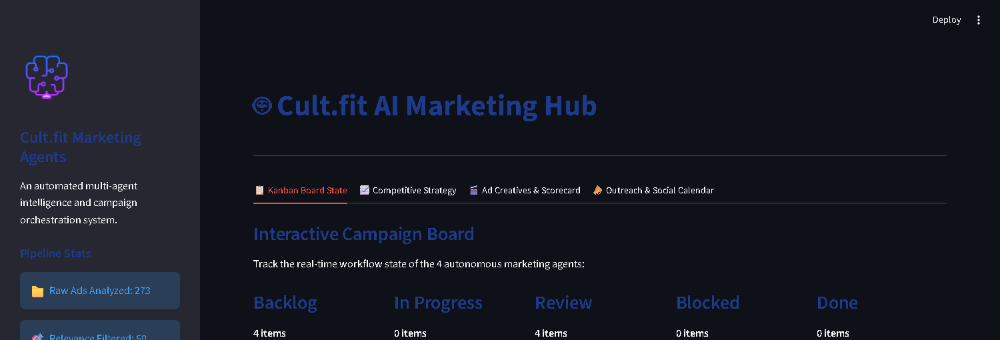
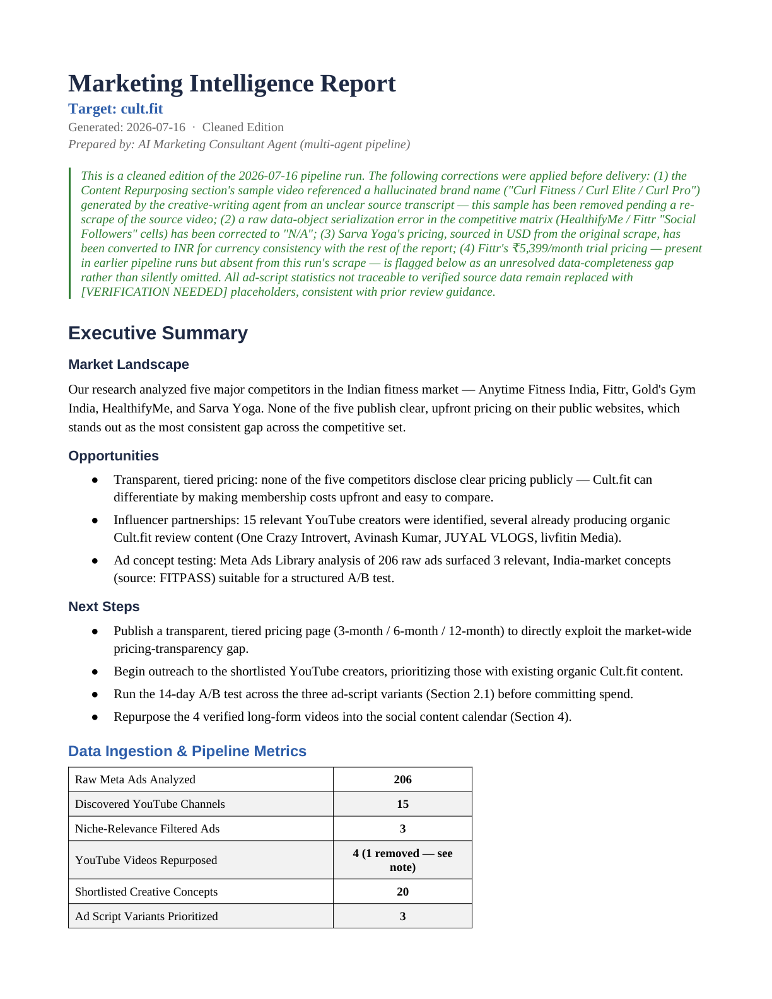
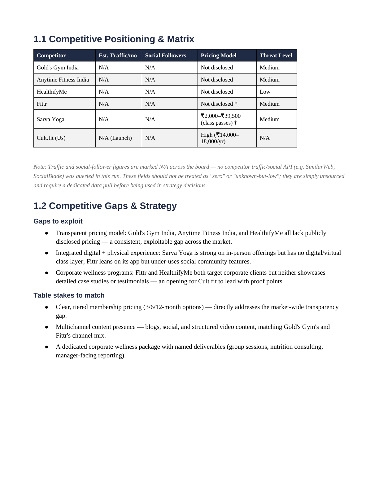
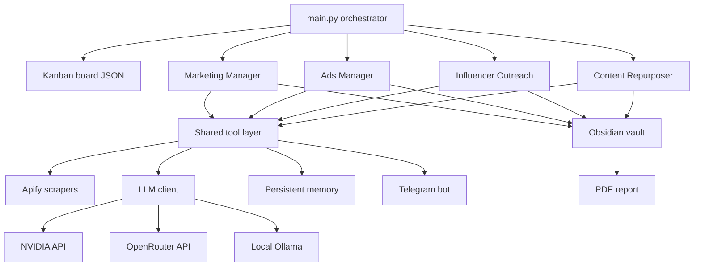

# Autonomous Multi-Agent Marketing Pipeline

[](https://github.com/Mat-rixMJ/Multi-Agent-Marketing-Automation-System/actions/workflows/ci.yml)
[](https://opensource.org/licenses/MIT)
[](https://www.python.org/downloads/)

A configurable, niche-agnostic marketing-intelligence system where four specialized agents run an end-to-end campaign workflow: competitor research, Meta Ads Library analysis, ad-script generation and scoring, influencer discovery and outreach, content repurposing, and a polished PDF report, coordinated over a JSON-backed Kanban board.

Point it at any niche (fintech, fitness, SaaS) through a single config file. It ships with a fully offline demo mode so you can run the whole pipeline in seconds with no API keys.

---

## Screenshots

<table>
  <tr>
    <td colspan="2"></td>
  </tr>
  <tr>
    <td width="50%"></td>
    <td width="50%"></td>
  </tr>
</table>

*Left to right: the Streamlit dashboard, the generated executive report, and the competitive-positioning matrix. All three are real output from the pipeline, not mockups.*

---

## Overview

**The problem.** Early-stage marketing means repeating the same manual grind for every launch: research competitors, dig through ad libraries for proven hooks, write and judge ad scripts, find relevant creators, draft outreach, and package it all for stakeholders. It is slow, inconsistent, and hard to repeat across niches.

**The solution.** This project automates that workflow as four cooperating agents driven by a shared Kanban board. Each agent owns one stage, reads the configured niche, calls an LLM (with scraping where live data helps), writes structured Markdown into an Obsidian-style vault, and advances its card. The final stage compiles everything into an executive PDF. Swap the niche in `data/config.json` and the same pipeline retargets end to end.

---

## Features

| Agent | Stage | What it does |
|-------|-------|--------------|
| **Marketing Manager** | Research & strategy | Researches the top competitors, writes per-competitor briefs, and synthesizes a positioning / gap-analysis strategy brief. |
| **Ads Manager** | Creative pipeline | Pulls the Meta Ads Library, filters for niche relevance, extracts pain/hook/offer concepts, generates three ad-script variants (fear, aspiration, social proof), scores them on a 50-point rubric, and auto-revises weak scripts. |
| **Influencer Outreach** | Discovery & outreach | Finds relevant YouTube creators, filters by reach, and drafts personalized outreach for each. |
| **Content Repurposer** | Distribution | Turns source videos into platform-native assets (X thread, LinkedIn post, short-form script) and a weekly posting calendar. |

Cross-cutting capabilities:

- **Niche-agnostic by config.** One `config.json` drives company name, niche, and competitor list across every stage.
- **Persistent memory.** `data/memory.json` deduplicates ads, tracks competitor positioning changes between runs, and skips already-drafted outreach so incremental runs do less work.
- **Resilient LLM client.** On HTTP 429 it reads `Retry-After`, backs off, rotates through free models, and falls back to a local Ollama model if every cloud provider fails.
- **Fact-check guardrails.** Generated scripts are scanned for unverified statistics and prohibited claims; the PDF generator runs a pre-flight integrity check that aborts on cross-niche leakage or duplicate content rather than shipping a broken report.
- **Offline demo mode.** `--demo` runs the full pipeline with deterministic mock responses and local fixtures, no keys, no network, no Telegram.
- **Interactive Telegram bot.** Query the latest run with `/status`, `/score`, `/competitors`, `/outreach @handle`, and `/changes`, or chat in free text.
- **Streamlit dashboard.** Browse the Kanban state, competitive strategy, ad scorecard, and outreach drafts in the browser.

---

## Architecture



The orchestrator (`main.py`) seeds the board and dispatches each skill's scripts in dependency order. `hermes_runner.py` offers an alternative runtime that executes the same skills through the Hermes Agent framework with model-invoked tool use.

---

## Tech stack

- **Language:** Python 3.11+
- **LLM providers:** OpenRouter, NVIDIA, local Ollama (OpenAI-compatible endpoints, with automatic failover)
- **Scraping:** Apify (Meta Ads Library, YouTube channels and transcripts, web research)
- **Reporting:** fpdf2 (PDF), Obsidian-style Markdown vault
- **Dashboard:** Streamlit
- **Bot:** python-telegram-bot
- **Agent runtime (optional):** Hermes Agent
- **Tooling:** pytest, ruff, GitHub Actions CI

---

## Quick start

### Windows (PowerShell)

```powershell
# 1. Clone and enter the project
git clone https://github.com/Mat-rixMJ/Multi-Agent-Marketing-Automation-System.git
cd Multi-Agent-Marketing-Automation-System

# 2. Create and activate a virtual environment
python -m venv .venv
.\.venv\Scripts\Activate.ps1

# 3. Install dependencies
pip install -r requirements.txt
pip install -r requirements-dev.txt

# 4. Run the full pipeline offline (no keys needed)
python main.py --demo
```

### macOS / Linux

```bash
git clone https://github.com/Mat-rixMJ/Multi-Agent-Marketing-Automation-System.git
cd Multi-Agent-Marketing-Automation-System
python -m venv .venv
source .venv/bin/activate
pip install -r requirements.txt
pip install -r requirements-dev.txt
python main.py --demo
```

`--demo` writes competitor briefs, a strategy brief, ad concepts and scored scripts, outreach drafts, a content calendar, and `output/marketing_report.pdf`, all from local fixtures.

### Run modes

| Command | Mode | Needs API keys |
|---------|------|----------------|
| `python main.py --demo` | Offline demo with mock responses and local fixtures | No |
| `python main.py --fresh` | Live run; wipes previous data and runs from scratch | Yes |
| `python main.py --incremental` | Live run; uses memory to skip already-processed items | Yes |
| `python hermes_runner.py` | Run skills through the Hermes Agent runtime | Yes |
| `streamlit run app.py` | Launch the dashboard | No |

### Live mode configuration

Copy the environment template and fill in the keys you need:

```powershell
Copy-Item .env.example .env   # macOS/Linux: cp .env.example .env
```

| Key | Purpose |
|-----|---------|
| `APIFY_TOKEN` | Apify scrapers (Meta Ads, YouTube, web research) |
| `LLM_PROVIDER` | `openrouter`, `nvidia`, or `ollama` |
| `OPENROUTER_API_KEY` / `OPENROUTER_MODEL` | OpenRouter provider and model |
| `NVIDIA_API_KEY` / `NVIDIA_MODEL` | NVIDIA provider and model |
| `OLLAMA_MODEL` | Local Ollama fallback model |
| `TELEGRAM_BOT_TOKEN` / `TELEGRAM_CHAT_ID` | Telegram run reports and bot (optional) |
| `OBSIDIAN_VAULT_PATH` / `KANBAN_BOARD_PATH` | Output locations (optional overrides) |
| `NICHE` / `PRODUCT_DESCRIPTION` / `TARGET_SITE` | Niche configuration (optional) |

### Tests and linting

```powershell
pytest          # unit tests: Kanban, memory, ad-score parsing, LLM failover
ruff check .    # lint (same check CI runs)
```

---

## Results and outputs

A single run produces, written to the Obsidian vault and `output/`:

- **5 competitor briefs** plus a synthesized strategy / gap-analysis brief
- **206 raw Meta ads** analyzed, relevance-filtered, and ranked down to a **20-ad shortlist**
- **20 ad concepts** extracted (pain / hook / offer / CTA)
- **3 ad-script variants** (fear, aspiration, social proof), scored on a 50-point rubric, with weak scripts auto-revised
- **15 influencer records** with **15 personalized outreach drafts**
- **5 repurposed content pieces** plus a weekly posting calendar
- **An 11-page executive PDF report** compiling all of the above

Sample reports for two different niches are included to show the system is niche-agnostic:

- [Cult.fit report](sample_reports/Cultfit_Marketing_Report_Clean.pdf) — Indian fitness market
- [CrowdWisdomTrading report](sample_reports/CrowdWisdomTrading_Marketing_Report_Clean.pdf) — retail trading education

---

## Project structure

```
.
├── main.py                 # Orchestrator: seeds board, dispatches skills
├── hermes_runner.py        # Alternative runtime via Hermes Agent
├── app.py                  # Streamlit dashboard
├── generate_pdf_report.py  # PDF compiler with pre-flight integrity checks
├── skills/                 # The four agents
│   ├── marketing_manager/
│   ├── ads_manager/
│   ├── influencer_outreach/
│   └── content_repurposer/
├── tools/                  # Shared layer
│   ├── llm_client.py       # Multi-provider LLM with failover + demo mode
│   ├── apify_client.py     # Scraper wrappers
│   ├── kanban.py           # JSON Kanban board
│   ├── memory.py           # Persistent run memory
│   ├── config_manager.py   # Niche configuration
│   └── telegram_bot.py     # Reports + interactive bot
├── data/                   # Config and intermediate artifacts
├── obsidian_vault/         # Markdown outputs (briefs, scripts, outreach)
├── sample_reports/         # Example PDFs for two niches
├── tests/                  # pytest suite
└── docs/screenshots/       # README images
```

---

## Engineering highlights

Developed iteratively; a few milestones from the commit history:

- **Multi-agent pipeline over a Kanban board** so stages run in dependency order with visible state transitions.
- **Resilient LLM layer** with rate-limit recovery (`Retry-After` + model rotation) and an Ollama fallback, so a run survives provider outages.
- **Closed-loop creative optimization:** scripts are scored on a 50-point rubric and auto-revised when they fall below threshold.
- **Fact-check and integrity guardrails:** unverified-statistic scanning, prohibited-claim blocking, and a PDF pre-flight check that fails loudly on cross-niche leakage or duplicate content.
- **Generalization from a single-niche prototype to a config-driven, niche-agnostic system,** verified against two different verticals.
- **Persistent memory** for incremental runs that skip already-processed work.
- **CI with ruff + pytest** on every push.

---

## What I learned

Building this taught me that the hard part of an agent pipeline is not the model calls, it is everything around them: keeping state consistent across stages, failing safely when an external API rate-limits or returns nothing, and making outputs trustworthy. Writing the pre-flight checks and fact-check scanners changed how I think about LLM output, assume it will occasionally be wrong and build guardrails that catch it before it reaches a stakeholder. Generalizing the system from one niche to any niche also showed me how much hidden coupling lives in "just a prompt," and how a deterministic offline demo mode is worth the effort for anyone who wants to try the project without credentials.

---

## Limitations and roadmap

- **Demo mode uses templated responses,** so the content is representative rather than genuinely researched. Live mode produces real, niche-specific analysis.
- **Scrapers depend on specific Apify actors;** actor availability and schemas can change.
- **Thin orchestration.** The Kanban loop is intentionally simple. At scale it would move to a real queue (Celery/RabbitMQ), memory to a database, and scraper/LLM calls to async batching.
- **LLM output parsing** relies on robust-but-not-bulletproof JSON extraction; structured-output libraries (Pydantic/Instructor) would harden it.
- **No observability yet;** tracing (LangSmith/Phoenix) would help tune prompts and track latency and cost.

---

## License

MIT. See [LICENSE](LICENSE).
